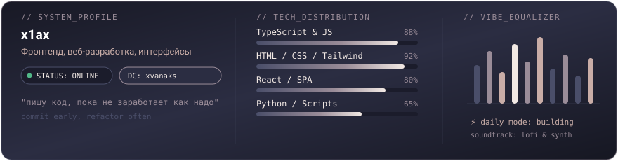

  <picture>
    <source media="(prefers-color-scheme: dark)" srcset="assets/header-dark.svg">
    <source media="(prefers-color-scheme: light)" srcset="assets/header-light.svg">
    
  </picture>

### йо 👋

Я **x1ax** (`sahanikityuk-cmyk`). Пишу код, пилю сайты и пет-проекты, ковыряюсь во фронтенде и стараюсь делать вещи, которые выглядят аккуратно и не бесят при использовании.

- 🛠 **С чем в основном вожусь:** TypeScript, JavaScript, React, вёрстка (HTML/CSS), а для скриптов и парсинга беру Python.
- 🎯 **Подход:** меньше оверинжиниринга, больше читаемого кода и приятного визуала.
- 👾 **Связь:** мой Discord — **`xvanaks`**. Пиши, если есть мысли что-то запилить вместе или просто пообщаться.

---

### 📊 System & Vibe Monitor

  <picture>
    <source media="(prefers-color-scheme: dark)" srcset="assets/widget-dark.svg">
    <source media="(prefers-color-scheme: light)" srcset="assets/widget-light.svg">
    
  </picture>

---

### 🛠 Стек

  

---

  дискорд для связи: <code>xvanaks</code> • палитра: <code>#2B2D42</code> <code>#4A4E69</code> <code>#9A8C98</code>

