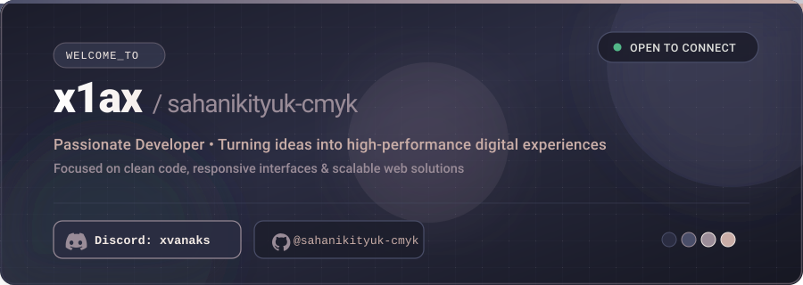

  <picture>
    <source media="(prefers-color-scheme: dark)" srcset="assets/header-dark.svg">
    <source media="(prefers-color-scheme: light)" srcset="assets/header-light.svg">
    
  </picture>

### вась 👋

Я **x1ax** (`@xvanaks`) — фуллстек разработчик(В будущем). Пишу код, создаю веб-приложения и пет-проекты, уделяя внимание чистоте архитектуры и удобству интерфейса.

- 🛠 **Что уже знаю: JavaScript, TypeScipt, HTML, CSS, Python**
- 🎯 **Принцип:** меньше оверинжиниринга, больше понятного кода и аккуратного визуала
- 💬 **Связь:** Discord — **`xvanaks`**

---

### 🐍 Активность

  <picture>
    <source media="(prefers-color-scheme: dark)" srcset="assets/github-snake-dark.svg">
    <source media="(prefers-color-scheme: light)" srcset="assets/github-snake-light.svg">
    
  </picture>

---

### 🛠 Стек и инструменты

  

---

  Discord: <code>xvanaks</code>

